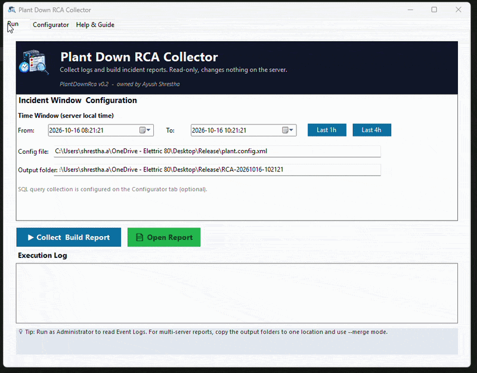

# PlantDownRca — Portable Plant-Down RCA Collector (v0.2)

**Author:** Ayush Shrestha

Client says "plant down." Instead of RDP-ing into three servers and hunting logs by hand,
you copy this folder to each involved server, run the exe with the incident time window,
and get one report: every error from every source, merged on a single timeline.

**No install. Read-only. Offline.** Delete the folder and it's gone — that's why it's allowed on prod.

**Tiny and native:** one self-contained **~1 MB** `PlantDownRca.exe` (~940 KB in the current build;
the whole folder is ~1.1 MB). It is a plain **Windows-native** .NET Framework 4.8 application —
.NET Framework 4.8 already ships with Windows Server 2016/2019/2022, so there is **nothing to
install, download, or register**. No MSI, no service, no driver, no dependencies to deploy.



*The app in action — set the incident window, collect from every source, and get one merged report.*

## How it's used (multi-server, the normal case)

1. Copy the `PlantDownRca` folder (exe + `plant.config.xml`) to **each** involved server:
   the SQL node that was **active at the time of the incident**, the application server,
   and the Kepware box if it's separate.
2. On each server, double-click `PlantDownRca.exe` (right-click → **Run as Administrator**,
   so Event Log and cluster channels can be read).
3. First run only: `plant.config.xml` is created automatically from the shipped example.
   Open the **Configurator** tab, add your application log folders (+ database boxes if you
   want SQL queries) and press **Save configuration** — the status line confirms what was
   saved. The **Help & Guide** tab explains every field.
4. Enter the incident window (or use Last 1h / Last 4h), click **Collect & Build Report**.
   Each run writes a folder `RCA-yyyyMMdd-HHmmss` containing `Report.html`, `timeline.csv`,
   `summary.txt`, and `entries.xml`.
5. Copy the run folders to one place (your laptop is fine) and merge them into one
   cross-server timeline:
   ```
   PlantDownRca.exe --merge "C:\RCA\run-from-sql" "C:\RCA\run-from-app" --out "C:\RCA\merged"
   ```
   ⚠️ Cross-server ordering is only as good as the servers' clock sync (NTP). The merged
   report says so, too.

CLI mode (same exe, no window):
```
PlantDownRca.exe --from "2026-10-06 14:00" --to "2026-10-06 15:00" --config plant.config.xml --out C:\Temp\RCA
```

## What it collects

| Source | How |
|---|---|
| .NET application text logs (any `*.log` / `*.txt` under the folders you add) | File parse — locked files OK (read-sharing), rolling files, stack traces kept together |
| SQL Server ERRORLOG / SQLAGENT.OUT | File parse from disk — no connection, no load on SQL. Error + its explanation line are merged; failover / Availability Group state lines are kept as evidence |
| Kepware (KEPServerEX) logs | File parse from a standard install's folders |
| Windows Event Logs | Application, System, FailoverClustering/Operational — time-filtered, Critical/Error/Warning |
| Health snapshot | Disk free, named service statuses, OS, approx. boot time — state at run time, labelled as such |

Then: **normalize → merge → sort → dedupe** (the same timeout 500 times = one row with a count)
→ pattern tags (`DISK_FULL`, `SQL_FAILOVER_OR_AG_MOVE`, `KEPWARE_PLC_COMMS_LOSS`,
`SERVICE_CRASHED`, `DB_DEADLOCK`, …) → earliest-error flagged. It assembles evidence;
it does **not** claim a root cause.

## Security & footprint

**Windows-native, no installer.** A single self-contained **~1 MB** `.NET Framework 4.8`
executable. .NET Framework 4.8 is a Windows component already present on Server 2016/2019/2022,
so nothing is downloaded or installed. No MSI, no Windows service, no driver, no scheduled task,
no registry writes.

**No network calls of its own.** The code contains no HTTP client, no sockets, no telemetry, no
update check, no cloud calls. The only network traffic is the optional SQL connection *you*
configure, to *your* server. Everything else is local file and Event Log reading.

**Read-only by design.**
- Log files are opened with read-sharing (locked/rolling files are fine) and are never modified.
- Event Logs are read through the standard Windows API; nothing is written.
- The only registry access is a **read** of the event-channel list (a fallback); nothing is written.
- SQL queries are **enforced read-only**: the collector refuses anything that is not a single
  `SELECT` / `WITH` statement — no `INSERT`/`UPDATE`/`DELETE`/`DROP`/`EXEC`/…, no statement
  chaining, no stored procedures. Use a **read-only SQL login** as defence in depth.
- The only files it writes are `plant.config.xml` (its own settings) and the `RCA-*` output folder.

**Runs as you, not as a service.** It runs in your user context. Administrator rights are needed
only so it can read the Security Event Log and cluster channels; without them it still runs and
simply reports what it could not read.

**What it does *not* do:** no install, no service, no driver, no firewall change, no outbound
connection except your SQL server, no data leaves the machine.

**Password handling (be aware).** The SQL password is stored **in clear text** in
`plant.config.xml` on that server (there is no encryption), is masked in the on-screen preview,
and is **never** written into any report. Prefer **Windows authentication** (no password stored)
or a **read-only** SQL login, and restrict NTFS permissions on `plant.config.xml` to the account
that runs the tool.

## Adapting it to a plant — `plant.config.xml`

One config file next to the exe, created for you when you press **Save configuration** on the
**Configurator** tab (you never have to write it by hand, and you never have to write a
connection string — see below). Folder lists can be left **empty**: with
`<DiscoveryEnabled>true</DiscoveryEnabled>` the exe auto-finds

- SQL logs: `Program Files\Microsoft SQL Server\MSSQL*\...\MSSQL\Log`,
- Kepware: `Program Files (x86)\Kepware`, `Program Files\Kepware`, `ProgramData\Kepware`.

Application log folders are **never guessed** — you add exactly the folders you want on the
Configurator tab. What it reads from them: every `*.log` and `*.txt` file, in the folder and
all subfolders, including rolling files written up to 2 days before the window start (entries
are then filtered by the timestamp inside each line).

### Database connection (optional) — no connection string to write

On the Configurator tab fill in four boxes — **Server (IP or host), Database, User name,
Password** — or tick **Windows authentication**. The connection string is assembled and
previewed for you, and **Test connection** confirms it works:

```
Server=10.0.0.5;Database=MyDatabase;User Id=report_user;Password=********;
```

The password is stored only in `plant.config.xml` on that server and never appears in any
report. SQL collection stays off (`EnableSqlQueries=false`) until you configure it, and every
query must be a single read-only `SELECT` using `@From` / `@To` — the collector **enforces**
this and refuses anything else (see *Security & footprint*).

Parsing is format-adaptive: several timestamp formats are tried per line
(SQL, log4net/NLog, US-style, ISO), and lines whose timestamp can't be parsed are
kept in an "Untimed" section — never silently dropped.

## Help inside the app

Every field has a hover tooltip, and the **Help & Guide** tab in the app covers: quick start,
which files are read from the application log folders, how to fill in the database
connection, what each output file is, multi-server merge, and troubleshooting.

## Building

Open `src\PlantDownRca\PlantDownRca.csproj` in Visual Studio 2022 → Build (Release).
Targets **.NET Framework 4.8** (present on your Windows Server 2016/2019/2022 fleet).
Output: `bin\Release\PlantDownRca.exe` (~940 KB) + copy `plant.config.example.xml` → `plant.config.xml`.

## The Windows "unknown publisher" warning (and signing)

The exe is **not code-signed**, so Windows may show *"Windows protected your PC"* (the blue
SmartScreen box) the first time it is run after being downloaded, or *"Unknown publisher"* in the
UAC prompt. This is expected for an unsigned internal tool and does **not** mean the file is
harmful — it means Windows cannot verify who built it.

Removing that warning requires a **code-signing certificate**, which is a separate purchase/asset
(not part of this project):

| Option | Removes the warning | Notes |
|---|---|---|
| **EV code-signing certificate** | Immediately | Hardware token / cloud HSM; ~$300–600/yr |
| **OV code-signing certificate** | After reputation builds | ~$200–400/yr; warnings fade over downloads |
| **Azure Trusted Signing** | Yes (managed) | Microsoft service, ~$10/mo, needs an Azure subscription |
| **Self-signed certificate** | Only on machines that trust it | Free; fine for a domain via GPO, useless for external sharing |

If a certificate is obtained, sign the built exe with `signtool` (from the Windows SDK), always
with an RFC 3161 timestamp so the signature outlives the certificate:

```
signtool sign /fd SHA256 /tr http://timestamp.digicert.com /td SHA256 ^
  /f mycert.pfx /p <password> src\PlantDownRca\bin\Release\PlantDownRca.exe
```

Until then, the practical workarounds are: copy the exe over a network share / USB (no
Mark-of-the-Web, so SmartScreen usually stays quiet), or click **More info → Run anyway**.

## Running the sample test

```powershell
powershell -ExecutionPolicy Bypass -File tests\run-samples.ps1
```

Builds the exe if needed, runs it against the synthetic logs in `tests\SampleLogs\` and
asserts 19 checks (dedupe, pattern tags, SQL explanation merge, stack-trace attachment,
untimed entries, all three file sources). Exits `0` on pass — see `tests\README.md`.

## Project layout

```
PlantDownRcaCollector.gif  Screen recording of the app in action (shown at the top)
src/PlantDownRca/
  Program.cs              UI + CLI + merge entry points
  UI/MainForm.cs          3-tab WinForms UI (Run / Configurator / Help), code-built, no designer files
  Models/LogEntry.cs      Normalized entry, grouped error, run package (entries.xml)
  Config/AppConfig.cs     plant.config.xml load/save
  Parsing/                Timestamp formats, level detection, multi-line log parser
  Discovery/              Auto-find SQL / Kepware log folders per machine
  Collectors/             App/SQL/Kepware file collectors, Event Log, health snapshot
  Core/                   Run engine, timeline merge + dedupe + pattern tags, package merger
  Report/                 Report.html / timeline.csv / summary.txt / entries.xml writers
tests/SampleLogs/         Synthetic sample logs (app, SQL, Kepware) — fake data only
tests/run-samples.ps1     One-command end-to-end check (19 assertions)
tests/sql-guard-test.ps1  Read-only SQL guard check (30 assertions, no database needed)
```

## Verification status

`tests\run-samples.ps1` passes all 19 checks, `tests\sql-guard-test.ps1` passes all 30
read-only-guard checks, and the full project (UI + Event Log + snapshot collectors) compiles
clean. **First real-world step: run it on one staging/test
server, then on a real incident window and compare the timeline against your manual check.**

## Known limits / next candidates

- Event Log snapshot of "current cluster owner" is not yet collected (event channels are).
- Pattern tags are regex rules in code (`Core/TimelineBuilder.cs → PatternTagger`) —
  moving them into the config file is planned so rules can grow without recompiling.
- Timestamps are treated as server-local. A source logging in UTC will look shifted;
  note it in the config when you find one.
- No AI summary in v1 — by design (prod has no internet). Later: summarize the exported
  `summary.txt` off-server.
